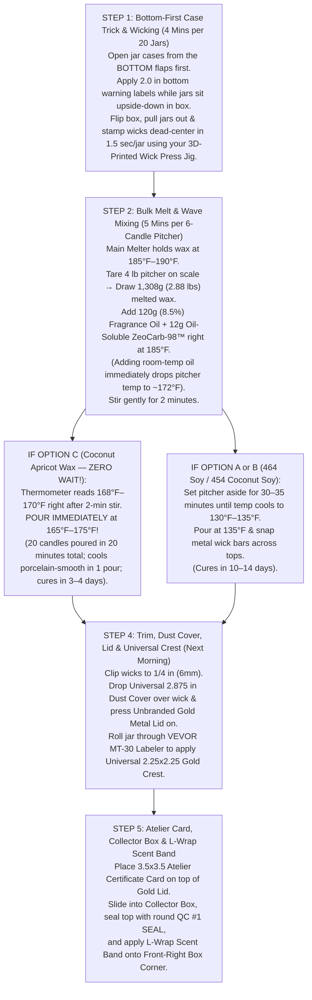

# Puck & Wick™ — Master Candle Specifics, Wax Chemistry, Pros & Cons, Costing & Pouring Playbook

> [!IMPORTANT]
> **Dedicated Candle-Only Master Reference:**
> This playbook consolidates **100% of our candle-specific breakdowns** from your previous conversations—including the side-by-side comparison of **Option A (`Golden Brands 464 Soy`)**, **Option B (`Golden Wax 454 Coconut Soy`)**, and **Option C (`CandleScience Coconut Apricot Wax`)**, every **positive and negative**, the real chemistry behind why luxury brands use a `5%–8%` pinch of food-grade paraffin, how **`170°F` hot-pouring eliminates your 35-minute waiting headache**, wick changes (`CD 18` vs. `LX 16 / LX 18`), down-to-the-penny COGS & margins at `$44.00` retail, live supplier links, and batch-pouring SOPs.
>
> *(A permanent backup copy is also saved in your project folder at [`CANDLE_SPECIFICS_AND_WAX_PLAYBOOK.md`](file:///Users/georgiiskrenov/Desktop/Puck%20&%20Wick%20Anti%20Gravity/CANDLE_SPECIFICS_AND_WAX_PLAYBOOK.md).)*

````carousel

<!-- slide -->

<!-- slide -->

````

---

## Part 1: The 3 Candle Wax Options — Complete Positives, Negatives & Chemistry Breakdown

When you charge **`$44.00` per `10 oz` candle** (`8.5 oz / 240g` net fill) or **`$108.00` for a Deluxe Collector Box**, your wax determines three critical things:
1. **Your Production Speed in the Basement** (whether you have to sit around waiting 35 minutes for pitchers to cool to `135°F`, or whether you can pour immediately at `170°F`).
2. **Your Curing Bottleneck** (waiting 14 full days before selling vs. 3–4 days).
3. **Customer First Impression & Hot Throw** (glass-smooth porcelain tops and room-filling scent throw vs. post-burn craters and chalky white frosting).

### 1.1 Side-by-Side Comparison Matrix (Option A vs. Option B vs. Option C)

| Feature / Production Metric | Option A: `Golden Brands 464` (100% Soy Baseline) | Option B: `Golden Wax 454` (100% Coconut-Soy, 0% Paraffin) | Option C: `CS Coconut Apricot` (Ultra-Luxury Hybrid Blend) |
| :--- | :--- | :--- | :--- |
| **Direct CandleScience Link** | [**Golden Brands 464 Soy Wax**](https://www.candlescience.com/wax/golden-brands-464-soy-wax/) | [**Golden Wax 454 Coconut Soy**](https://www.candlescience.com/wax/golden-wax-454-coconut-soy-wax/) | [**CandleScience Coconut Apricot Wax**](https://www.candlescience.com/wax/candlescience-coconut-apricot-wax/) |
| **45 lb Case Price (In Stock)** | **`$108.47`** *(`$2.41/lb`)* | **`$124.85`** *(`$119.31` at 5+ cases = `$2.65/lb`)* | **`$153.28`** *(`$119.18` bulk = `$3.40/lb`)* |
| **Wax Cost Per Candle (`218g / 7.69 oz`)** | **`$1.16 / candle`** | **`$1.33 / candle`** *(Only `+$0.17` over 464)* | **`$1.63 / candle`** *(Only `+$0.47` over 464)* |
| **What It's Made Of** | 100% Hydrogenated Soybean Oil + soy-based additive | **100% Plant-Based:** American Soybeans + Natural Coconut Wax | **~92–95% Natural Apricot, Coconut & Soy** + **~5–8% FDA Food-Grade Paraffin** |
| **Paraffin Content** | `0%` Paraffin | **`0%` Paraffin (100% Vegan/Plant)** | `~5–8%` Ultra-Refined Food-Grade Paraffin |
| **Add Fragrance + `ZeoCarb-98™` Temp** | `185°F` | `185°F` | **`185°F–190°F`** |
| **Target Pouring Temperature** | `135°F` ($\pm 5^\circ\text{F}$) | `125°F–135°F` | **`165°F–175°F` (POUR PIPING HOT!)** |
| **Waiting Time After Mixing FO** | ❌ **30–35 Minutes per pitcher** | ❌ **30–40 Minutes per pitcher** | ✅ **0 MINUTES (Pour immediately after 2-min stir!)** |
| **Tops After 1 Pour** | ❌ Prone to craters, sinkholes & chalky frosting | ⚠️ Smooth if poured cool (`130°F`), sinkholes if poured hot | ✅ **Glass-smooth, glossy porcelain white in 1 hot pour** |
| **Cure Time Before Burning / Selling** | ❌ **14 Full Days** | ⚠️ **10–14 Days** | ✅ **48 Hours to 4 Days!** |
| **Hot Throw on Heavy Luxury Scents** *(Baccarat 540 / Top Shelf, Santal, Bourbon)* | `7.5 / 10` (Can mute heavy woods/amber) | `9.0 / 10` (Coconut lipid boosts throw ~25%) | **`10 / 10` (Explosive $85-Designer-Tier Room Throw)** |
| **Required Wick in Your `3.06"` Jars** | `CD 18` (Woods) / `CD 12` (Fresh) | `CD 18` (Woods) / `CD 12` (Fresh) | **`LX 18` (Woods) / `LX 16` (Fresh)** *(or `CD 8 / CD 10`)* |

---

### 1.2 Detailed Breakdown of Every Wax: All Positives (+) and Negatives (-)

#### Option A: `Golden Brands 464 Soy Wax` (`$108.47` / 45 lb case = `$1.16` per candle)
* **The Positives (+):**
  * **Cheapest Baseline Cost:** `$1.16` per candle (`218g` wax).
  * **100% Plant-Based / Zero Paraffin:** Allows you to say *"100% American-Grown Soy Wax • 0% Paraffin"* with zero caveats.
  * **Widely Available:** Stocked in every US candle warehouse (CandleScience Durham NC & Fillmore Container Lancaster PA).
* **The Negatives (-):**
  * **The 35-Minute Cooling Wait Headache:** After heating to `185°F` and mixing your fragrance oil, you have to let the pitcher sit for **30–35 minutes** until it drops to `135°F` before pouring. If you pour 464 hot at `170°F`, it shrinks unevenly and rips open sinkholes around the wick.
  * **Long 14-Day Cure Time:** Because 464 forms rigid polymorphic $\beta'$ fat crystals, it takes a full **2 weeks** for the crystal lattice to lock around fragrance molecules.
  * **Bumpy Post-Burn Tops & Frosting:** After a customer blows the candle out for the first time, pure 464 almost always solidifies with rough, cratered, or chalky white tops.
  * **Softer Hot Throw on Complex Base Notes:** Heavy luxury scents (*Top Shelf / Baccarat 540*, *Barnwood & Bourbon*, *Velvet Vanilla & Santal*) get partially trapped in pure soy's dense crystal structure.

---

#### Option B: `Golden Wax 454 Coconut Soy Wax` (`$124.85` / 45 lb case = `$1.33` per candle)
* **The Positives (+):**
  * **100% Paraffin-Free (Keep All Current Website & Box Claims):** Made strictly from **American Soy + Natural Coconut Oil** (`0.0% Paraffin`). You don't have to change a single word on your website or Atelier Certificate Cards.
  * **Fixes 464's Frosting & Post-Burn Craters:** The buttery coconut oil lipids soften the soy crystal structure so tops set creamy-white and reset much smoother after burning.
  * **~25% Stronger Hot Throw Than 464:** Coconut oil is a superior carrier for heavy amber, wood, and musk molecules.
  * **Uses the Exact Same `CD 12 / CD 18` Wicks:** No need to re-wick from your baseline soy setup.
  * **Only `+$0.17` More Per Candle Than 464:** Costs just `$32.76` more across a 108-candle run worth `$4,752.00` retail.
* **The Negatives (-):**
  * **Still Has the 30–40 Minute Cooling Wait:** Because it is 100% vegetable triglycerides (zero paraffin crystal-breaker), you **still cannot pour it hot at `170°F`**—you have to wait until it cools to `125°F–135°F` in the pitcher before pouring.
  * **Still Needs a 10–14 Day Cure Time:** Takes nearly two weeks to reach peak hot throw.

---

#### Option C: `CandleScience Coconut Apricot Wax` (`$153.28` / 45 lb case = `$1.63` per candle)
* **The Positives (+):**
  * **ZERO Waiting Time — Pour Immediately at `170°F`!** You pull wax from the melter at `185°F`, add room-temperature fragrance oil (`8.5%–10%`) + `ZeoCarb-98™` (which automatically drops the pitcher temp to `~172°F`), stir for **2 minutes**, and **pour immediately right at `168°F–170°F`**. You can pour 20 candles in 20 minutes without ever setting a pitcher down to cool!
  * **Cures in 3–4 Days Instead of 14 Days:** Ready to test-burn, sell, or ship in **48 to 96 hours**.
  * **Porcelain-Smooth Single-Pour Tops (Zero Heat-Gunning):** Even when poured piping hot at `170°F`, it cools into a glossy, mirror-flat, creamy white surface with zero sinkholes, zero craters, and zero frosting.
  * **10/10 Designer-Level Hot Throw:** Fills an entire living room within 20 minutes of lighting—matching `$75–$95` candles from *Byredo*, *Diptyque*, *Le Labo*, and *Voluspa*.
  * **Slower, Cooler Burn (60–65 Hours):** Because it uses smaller `LX 16 / LX 18` wicks, the wax consumes more slowly and cleanly.
  * **Only `+$0.47` More Per Candle:** On a `$44.00` candle, spending `$1.63` on wax instead of `$1.16` changes your profit margin by less than `1%` (`88.9%` vs. `90.0%` in bulk).
* **The Negatives (-):**
  * **Contains `~5%–8%` Food-Grade Paraffin:** While it is 92–95% natural Apricot, Coconut, and Soy wax, it contains a tiny pinch of FDA food-grade refined paraffin. That means **you must replace the phrase `"0% Paraffin"` on your website/cards** with **"Luxury Coconut-Apricot & American Soy Crème Wax • 100% Phthalate-Free, Paraben-Free & Clean-Burning"** (the exact phrasing used by *Voluspa* and luxury department-store brands).
  * **Requires Smaller Wicks (`LX 16 / LX 18` instead of `CD 18`):** Putting a huge `CD 18` soy wick into Coconut Apricot wax will cause a high, flickering flame and black soot. You must use **`LX 18`** (heavy scents) and **`LX 16`** (lighter scents).

---

### 1.3 The Real Chemistry: Why That `5%–8%` Pinch of Food-Grade Paraffin Solves Your Biggest Headaches

1. **What kind of paraffin is in Option C?**
   It is **not** industrial crude oil sludge—it is **hydrotreated, FDA food-grade paraffin** (the exact same purified, odorless, non-toxic wax sprayed onto grocery store apples, chocolates, and cheeses).
2. **Why do master blenders add `5%–8%` of it to Apricot, Coconut, and Soy wax?**
   * **Pure Vegetable Waxes Have "Rigid Crystal Lattice" Syndrome:** 100% soy (`464`) and 100% coconut-soy (`454`) are made of huge, clunky triglyceride molecules. As they cool, they lock into a rigid crystal cage ($\beta'$ crystals).
   * If you pour pure vegetable wax hot at `170°F`, the outer wax against the glass cools first while the center stays hot for an hour. As those rigid crystals shrink and pull toward the glass, they rip open **sinkholes and craters around the wick**. That is why 100% plant waxes force you to wait 35 minutes until the pitcher is sluggish (`135°F`).
   * Those rigid crystals also take **14 days** to finish shifting around your fragrance oil.
   * **How the `5%–8%` Food-Grade Paraffin Acts as a "Crystal-Breaker":** Paraffin molecules are tiny, smooth, flexible chains. Adding just a pinch into Coconut, Apricot, and Soy wax prevents rigid crystals from locking up—allowing you to **pour piping hot at `170°F` with zero sinkholes**, **cure in 3–4 days**, and **release 100% of your heavy fragrance notes into the air**.

---

## Part 2: Critical Wick Sizing & Fragrance Oil Warnings

### 2.1 Exact Wick Chart by Wax Type for Your `3.06"` Diameter (`10 oz`) Tumblers

> [!CAUTION]
> **Never put a `CD 18` wick inside Option C (`Coconut Apricot Wax`)!**
> Because Coconut Apricot wax melts much more easily than thick 464 soy wax, a `CD 18` will create a 2-inch flame and smoke up your Matte Black and Frosted Ivory jars. Match your wick to your wax below:

| Scent Profile in Your 10-Candle Lineup | If Using Option A (`464 Soy`) or Option B (`454 Coconut Soy`) | If Using Option C (`CS Coconut Apricot Wax`) |
| :--- | :--- | :--- |
| **Heavier Woods, Amber, Leather & Spice Scents:**<br>• *Top Shelf* (Baccarat 540 / Saffron / Amberwood)<br>• *Barnwood & Bourbon*<br>• *Velvet Vanilla & Santal*<br>• *Balsam & Cedarwood*<br>• *Warm Amber & Cashmere* | [**CandleScience — CD 18 6" Pretabbed Wick**](https://www.candlescience.com/wick/cd-18/) *(100-pc bag = `$10.49`)* | [**CandleScience — LX 18 6" Pretabbed Wick**](https://www.candlescience.com/wick/lx-18/) *(100-pc bag = `$9.99`)*<br>*(Alternate: `CD 10`)* |
| **Lighter Fresh, Mint, Tea & Citrus Scents:**<br>• *Fresh Cut* (Ice Rink / Ozone / Mint)<br>• *Locker Room Mint & Eucalyptus*<br>• *Cashmere & White Tea*<br>• *White Lavender & Linen*<br>• *Sea Salt & Orchid* | [**CandleScience — CD 12 6" Pretabbed Wick**](https://www.candlescience.com/wick/cd-12/) *(100-pc bag = `$10.06`)* | [**CandleScience — LX 16 6" Pretabbed Wick**](https://www.candlescience.com/wick/lx-16/) *(100-pc bag = `$9.99`)*<br>*(Alternate: `CD 8`)* |

---

### 2.2 Critical Warning on "Diffuser Oils" vs. True Candle-Safe Fragrance Oils
Earlier you mentioned buying **`AirScent Fresh Cut Balsam Fir Diffuser Oil (500 mL)`** and **`AirScent Baccarat 540 Dupe`** on Amazon:
1. **Check for Carrier Solvents:** AirScent sells both *Pure Fragrance Oils* and *Cold-Air HVAC Nebulizing Diffuser Oils*. Oils formulated strictly for ultrasonic/HVAC room diffusers are often thinned with volatile carrier solvents (like DPG or glycol ethers) that have low flashpoints and **do not bind with hot candle wax**—causing wax sweating (oil puddles on top of your candle), air pockets, or weak hot throw.
2. **Switch to Wholesale IFRA Candle-Safe Oils (Saves `$1.00/candle` + Better Throw):**
   * Buying 500 mL bottles on Amazon costs you **`~$2.25–$2.50 per oz`**.
   * Ordering **16 oz or 5 lb jugs** of **IFRA-Certified Candle & Soap Safe Fragrance Oils** from [**CandleScience CleanScents™**](https://www.candlescience.com/fragrance-oil/all-fragrance-oils/), [**Midwest Fragrance Co.**](https://midwestfragranceco.com), or [**Simbi Fragrance**](https://simbifragrance.com) drops your oil cost to **`$1.35–$1.60 per oz`** (`~$1.15` per candle at `8.5%` load), guarantees a high flashpoint (`>150°F`) engineered for soy/coconut-apricot wax, and is 100% skin-safe (`IFRA Category 9`) when you use the same scent in your Body Washes!

---

### 2.3 The Odor-Eliminating Secret inside Your Candles: Oil-Soluble `ZeoCarb-98™` (`99% Metazene®`)
* **Never put water-soluble deodorizer into candle wax!** Water-based additives sink to the bottom of melted wax and make the wick pop and sizzle.
* **What You Add to Every Candle:** Add **`2g to 3g` (`~1.0%` load = `$0.10–$0.12` per candle)** of **Oil-Soluble 99% Metazene® Candle Additive** ([**Sunshine Candle Supply — Odor B Gone 99% Metazene**](https://www.sunshinecandlesupply.com/ODOR-B-GONE-99-METAZENE-TURN-ANY-CANDLE-INTO-AN-ODOR-ELIMINATOR-FREE-SHIPPING_p_346.html) or [**Community Candle Supply — Odor Eliminator Candle Additive**](https://communitycandlesupply.com/products/odor-eliminator-additive-for-candles-fragrance-oil)) right along with your fragrance oil at `185°F`.
* **How It Works:** As the candle burns, the warm wax pool releases colorless, odorless aliphatic ester molecules into the room air BEFORE they hit the flame, chemically binding and neutralizing kitchen, pet, and locker-room odors in the air while your luxury fragrance fills the room.

---

## Part 3: Down-to-the-Penny Candle Cost Breakdown & Profit Margins (`$44.00` Retail)

### 3.1 Exact Formula Math per 1 Candle (`8.5 oz / 240g` Net Fill) & per 6-Candle Pitcher
Your `10 oz` straight-sided tumbler (`3.06"` OD × `3.5"` H; `11.9 fl oz` brim volume) takes an **`8.5 oz (240g)` net fill** so there is clean headspace for the **Universal `2.875"` Dust Cover**, the **`1/4"` wick**, and the **Unbranded Brushed Gold Metal Lid**:

* **Per Single `10 oz` Candle (`240g / 8.5 oz` Net Fill):**
  * **Wax (`90.8%`):** **`218g`** (`7.69 oz`)
  * **Fragrance Oil (`8.5%` load):** **`20g`** (`0.70 oz`) *(or `22g` at `9.2%` load)*
  * **Oil-Soluble `ZeoCarb-98™` / Metazene® (`0.8%–1.0%` load):** **`2g`** (`0.07 oz`)
  * **Total Net Fill Weight:** **`240g` (`8.5 oz`)**
* **Per 6-Candle Pouring Pitcher (`1,440g` Total Batch):**
  * **Wax:** **`1,308g` (`2.88 lbs`)** drawn from your main melter at `185°F`
  * **Fragrance Oil (`8.5%`):** **`120g` (`4.23 oz`)** added at `185°F`
  * **Oil-Soluble `ZeoCarb-98™` (Metazene®):** **`12g` (`0.42 oz`)** added with fragrance oil

---

### 3.2 Component-by-Component COGS Breakdown (Across All 3 Wax Options)

| Candle Component | Exact Spec (`v58` Architecture) | Domestic Pilot Cost (108-Unit Run) | Scaled / Alibaba Bulk Cost (300–500 Units) |
| :--- | :--- | :---: | :---: |
| **1. `10 oz` Tumbler Jar** | `3.06"` OD × `3.5"` H Heavy-Base Glass (Matte Obsidian Black for Men's; Frosted or Opaque White for Women's) | **`$2.62`** *(CandleScience 12-pc case @ `$31.47`)* | **`$0.95`** *(Alibaba / bulk pallet)* |
| **2. Unbranded Brushed Gold Metal Lid** | `3.25"` Flat Brushed Gold Lid w/ Inner Silicone Fitment Gasket | **`$0.99`** *(CandleScience 12-pack @ `$11.97`)* | **`$0.35`** *(Alibaba bulk)* |
| **3. Candle Wax (`218g / 7.69 oz`)** | • **Option A (`464 Soy`):** `$108.47 / 45 lb case`<br>• **Option B (`454 Coconut Soy`):** `$124.85 / 45 lb case`<br>• **Option C (`Coconut Apricot`):** `$153.28 / 45 lb case` | • **Opt A:** `$1.16`<br>• **Opt B:** `$1.33`<br>• **Opt C:** **`$1.63`** | • **Opt A:** `$0.94`<br>• **Opt B:** `$1.12`<br>• **Opt C:** **`$1.35`** |
| **4. CleanScents™ Fragrance Oil (`20g`)** | Phthalate-Free IFRA-Certified Oil (`8.5%` load) | **`$1.15`** *(16 oz bottles)* | **`$0.95`** *(5 lb–25 lb jugs)* |
| **5. Oil-Soluble `ZeoCarb-98™` (`2g–3g`)** | 99% Metazene® Molecular Odor Eliminator Additive | **`$0.10`** | **`$0.06`** |
| **6. Pretabbed Wick + Pro Wick Sticker** | `LX 16 / LX 18` (for Option C) or `CD 12 / CD 18` (for Options A & B) + 3M Wick Sticker Pro | **`$0.16`** | **`$0.06`** |
| **7. Universal Front Gold Crest (`2.25"×2.25"`)** | Square Matte Black / Cream BOPP w/ Brushed Gold Foil `PUCK & WICK` Crest *(Zero scent name on jar!)* | **`$0.24`** | **`$0.09`** |
| **8. Universal `2.875"` Wax Dust Cover** | Pull-tab cardstock circle (`PUCK & WICK™ • LOUDOUN CO., VA`) | **`$0.11`** | **`$0.04`** |
| **9. `2.0"` Bottom Safety Warning Label** | Waterproof polypropylene ASTM warning sticker | **`$0.04`** | **`$0.02`** |
| **SUBTOTAL: FINISHED LIDDED CANDLE JAR (NO BOX)** | *(Used when placing candle inside the `$108` Deluxe Collector Box)* | • **Opt A (`464`):** `$6.57`<br>• **Opt B (`454`):** `$6.74`<br>• **Opt C (`Coco-Apricot`):** **`$7.04`** | • **Opt A (`464`):** `$3.46`<br>• **Opt B (`454`):** `$3.64`<br>• **Opt C (`Coco-Apricot`):** **`$3.87`** |
| **10. Individual Candle Collector Box + Card + L-Wrap Band** | • Soft-Touch / Two-Piece Gold-Neck Box (`$1.02` pilot / `$0.65` bulk)<br>• `3.5"×3.5"` Double-Sided Atelier Certificate Card (`$0.14` / `$0.06`)<br>• L-Wrap Corner Scent Band + Top `QC #1 SEAL` (`$0.07` / `$0.03`) | **`+$1.23 / box set`** | **`+$0.74 / box set`** |
| **TOTAL ALL-IN BOXED `$44` CANDLE COGS** | **Complete Retail-Boxed Candle Ready to Ship** | • **Opt A (`464`):** **`$7.80`** *(or `$8.08` w/ extra labels)*<br>• **Opt B (`454`):** **`$7.97`** *(or `$8.25`)*<br>• **Opt C (`Coco-Apricot`):** **`$8.27`** *(or `$8.55`)* | • **Opt A (`464`):** **`$4.20`** *(or `$4.35`)*<br>• **Opt B (`454`):** **`$4.38`** *(or `$4.52`)*<br>• **Opt C (`Coco-Apricot`):** **`$4.61`** *(or `$4.82`)* |

---

### 3.3 DTC Retail (`$44.00`) vs. 50% Wholesale (`$22.00`) Profit Margins

| Wax Choice | Pilot COGS (Boxed) | Bulk COGS (Boxed) | DTC Profit & Margin @ `$44.00` Retail | 50% Wholesale Profit & Margin @ `$22.00` |
| :--- | :---: | :---: | :---: | :---: |
| **Option A: `464 Soy`** | `$8.08` | `$4.35` | **`+$35.92 (81.6%)` → `+$39.65 (90.1%)`** | **`+$13.92 (63.3%)` → `+$17.65 (80.2%)`** |
| **Option B: `454 Coconut Soy` (0% Paraffin)** | `$8.25` | `$4.52` | **`+$35.75 (81.3%)` → `+$39.48 (89.7%)`** | **`+$13.75 (62.5%)` → `+$17.48 (79.5%)`** |
| **Option C: `Coconut Apricot` (170°F Pour)** | `$8.55` | `$4.82` | **`+$35.45 (80.6%)` → `+$39.18 (89.0%)`** | **`+$13.45 (61.1%)` → `+$17.18 (78.1%)`** |

---

## Part 4: Live-Verified US Candle Supplier Shopping Cart (108-Candle Run = `$4,752` Retail Value)

> [!TIP]
> **Northern Virginia Freight Hack (`Purcellville, VA 20132`):**
> **CandleScience's** East Coast fulfillment hub is in **Durham, NC** (2–3 day ground shipping to Loudoun County), and [**Fillmore Container**](https://www.fillmorecontainer.com) is in **Lancaster, PA** (only ~2.5 hours north of Purcellville if you ever want to pick up multi-case wax/glass orders with zero shipping fees!).

| # | Candle Item to Order | Live-Verified In-Stock Supplier Link | Qty for 108 Candles | Unit Cost | Total Outlay |
| :--- | :--- | :--- | :---: | :---: | :---: |
| **1** | **Men's `10 oz` Matte Obsidian Jars** | [**CandleScience — Matte Black Tumbler Jar (12-pc Case)**](https://www.candlescience.com/containers/matte-black-tumbler-jar/) | **6 Cases** *(72 Jars)* | `$2.62 / jar` | **`$188.82`** |
| **2** | **Women's `10 oz` Sanctuary Frosted / White Jars** | [**CandleScience — Frosted Tumbler Jar**](https://www.candlescience.com/containers/frosted-tumbler-jar/) *(or [White Tumbler](https://www.candlescience.com/containers/tumbler-jar/?color=white&variant=1-pc-box))* | **3 Cases** *(36 Jars)* | `$2.62 / jar` | **`$94.41`** |
| **3** | **Unbranded Brushed Gold Metal Flat Lids** | [**CandleScience — Gold Metal Flat Lid (12-pc Pack)**](https://www.candlescience.com/containers/gold-metal-flat-lid/) | **9 Packs** *(108 Lids)* | `$0.99 / lid` | **`$107.73`** |
| **4** | **2 Cases (90 lbs) of Candle Wax** *(Choose Option B or C)* | • **Option B (`0% Paraffin`):** [**Golden Wax 454 Coconut Soy**](https://www.candlescience.com/wax/golden-wax-454-coconut-soy-wax/) (`$124.85/case`)<br>• **Option C (`170°F Pour`):** [**CS Coconut Apricot Wax**](https://www.candlescience.com/wax/candlescience-coconut-apricot-wax/) (`$153.28/case`) | **2 Cases** *(90 lbs)* | `$1.33` *(Opt B)*<br>`$1.63` *(Opt C)* | **`$249.70`** *(Opt B)*<br>**`$306.56`** *(Opt C)* |
| **5** | **6" Pretabbed Wicks + Pro Stickers** | • **If Option C:** [**LX 18**](https://www.candlescience.com/wick/lx-18/) + [**LX 16**](https://www.candlescience.com/wick/lx-16/)<br>• **If Option B:** [**CD 18**](https://www.candlescience.com/wick/cd-18/) + [**CD 12**](https://www.candlescience.com/wick/cd-12/)<br>• Plus [**Wick Stickers Pro (200 Roll)**](https://www.candlescience.com/equipment/wick-stickers-pro/) | **1 Bag Each + 1 Roll** | `$0.16 / set` | **`$26.28`** |
| **6** | **IFRA Phthalate-Free Fragrance Oils (`80 oz` total)** | [**CandleScience — CleanScents™ 16 oz Bottles**](https://www.candlescience.com/fragrance-oil/all-fragrance-oils/) *(Fraser Fir, Saffron Cedarwood, etc.)* | **5 × 16 oz Bottles** | `$1.15 / candle` | **`$124.00`** |
| **7** | **Oil-Soluble `ZeoCarb-98™` (99% Metazene®)** | [**Sunshine Candle Supply — Odor B Gone 99% Metazene**](https://www.sunshinecandlesupply.com/ODOR-B-GONE-99-METAZENE-TURN-ANY-CANDLE-INTO-AN-ODOR-ELIMINATOR-FREE-SHIPPING_p_346.html) *or* [**Community Candle Supply**](https://communitycandlesupply.com/products/odor-eliminator-additive-for-candles-fragrance-oil) | **1 × 16 oz Bottle** | `$0.10 / candle` | **`$18.50`** |
| **8** | **Individual Soft-Touch Tumbler Boxes** | **Black:** [**CS Black Luxe Soft Touch Box**](https://www.candlescience.com/packaging/black-luxe-soft-touch-tumbler-box/)<br>**White:** [**CS White Luxe Soft Touch Box**](https://www.candlescience.com/packaging/white-luxe-soft-touch-tumbler-box/) | **6 Packs Black (72) + 3 Packs White (36)** | `$1.02 / box` | **`$109.62`** |
| **9** | **Universal `2.25"×2.25"` Gold Crest + L-Wrap Scent Bands + Dust Covers + `3.5"×3.5"` Atelier Cards + Warning Labels** | • [**StickerApp Metallic Gold Labels**](https://www.stickerapp.com/custom-stickers/metallic-stickers) (`$72`)<br>• [**OnlineLabels OL712 L-Wrap Bands**](https://www.onlinelabels.com/products/ol712) (`$14`)<br>• [**Norman's Printery `2.875"` Dust Covers**](https://normansprintery.com/candle-dust-covers/) (`$27.50`)<br>• [**Moo / GotPrint `3.5"×3.5"` Square Cards**](https://www.moo.com/us/business-cards/square) (`$35`)<br>• [**CS 2" Warning Labels**](https://www.candlescience.com/equipment/2inch-labels/) (`$8.28`) | **200–250 Sets** *(Leaves 92+ extra sets for Batch #2!)* | `$0.60 / full print set` | **`$156.78`** |
| **TOTAL** | **Complete 108-Candle Starter Production Run** | **Produces `$4,752.00` in Retail Candle Inventory (`108 × $44.00`)** | **108 Boxed Candles** | **`$8.25–$8.55 / unit`** | **`$1,075.84`** *(Opt B)*<br>**`$1,132.70`** *(Opt C)* |

---

## Part 5: High-Speed Basement Pouring SOP (`Option C: 170°F Zero-Wait Workflow` vs. `Option B: 135°F Workflow`)

### 5.1 Why Your Universal Jar Architecture Makes Pour Day 3x Faster
Because every Men's jar gets the **exact same `2.25" × 2.25"` Universal Square `PUCK & WICK` Crest** and **1 Universal `2.875"` Dust Cover** (with the scent name placed **only on the L-Wrap Box Corner Band**), you never have to worry about mislabeling jars or ordering 10 different jar stickers!

### 5.2 Step-by-Step 20-Candle / 60-Candle Batch SOP



---

## Part 6: Recommended Candle Workshop Equipment Upgrades (From Just Your Wax Melter)

| Stage | Tool / Upgrade & Link | Cost | Time Saved (per 50 Candles) | Why It Matters for Candles |
| :--- | :--- | :---: | :---: | :--- |
| **Day 1** | **1) Free 3D-Printed [`BONUS_10oz_Tumbler_Wick_Centering_Press_Jig.stl`](file:///Users/georgiiskrenov/Desktop/Puck%20&%20Wick%20Anti%20Gravity/3D_Print_Files_Puck_And_Wick/BONUS_10oz_Tumbler_Wick_Centering_Press_Jig.stl)** *(or [CS Small Single Wick Setter](https://www.candlescience.com/equipment/candlescience-small-single-wick-setter/) — `$6.14`)*<br>**2) 6x [CS Metal Wick Bars](https://www.candlescience.com/equipment/wick-bar/)** (`$5.08/ea`)<br>**3) 3x [CS 4 lb Pouring Pitchers](https://www.candlescience.com/equipment/pouring-pitcher/)** (`$13.49/ea`) | **`$70.95`** | **Saves 45 mins** | You can't see through the bottom of opaque Matte Black jars to center wicks by eye. The press jig stamps the wick dead-center in 1.5 seconds per jar. |
| **At 30+ Candles** | **VEVOR MT-30 Manual Round Jar Label Applicator** *(Amazon / [Vevor.com](https://www.vevor.com))* | **`$98–$109`** | **Saves 65 mins** | Applies your `2.25" × 2.25"` Universal Gold Front Crest at the exact same millimeter height on every jar in 3 seconds flat. |
| **At 50+ Candles** | **2.2L Stainless Steel Piston Wax Dispensing Funnel w/ Spring Valve** *(Amazon)* + **Wagner Furno 300 Heat Gun** | **`$64.00`** | **Saves 40 mins** | Pouring from an open pitcher spout onto black inner glass walls leaves messy wax streaks. A bottom-valve funnel drops `240g` straight down the center with zero splashes. |
