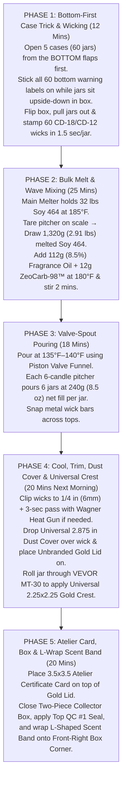

# Puck & Wick™ — Master Manufacturing, Sourcing, Pricing & Production Playbook (v54 Consolidated Edition)

> [!IMPORTANT]
> **Everything From Your Previous Manufacturing Conversation — Consolidated & Updated for v54:**
> This master playbook combines **100% of the notes, live-verified supplier links, exact SKUs, unit pricing/COGS, workshop equipment upgrades, batch-pouring SOPs, 3D-print `.STL` files, and Alibaba turnkey RFQs** from your previous tab, fully updated to match your latest **v54 catalog architecture** (`$44` Candles, `$48` 3.0" ZeoCarb-98™ Puck, `$38` 2.0" Mini Pucks Set of 2, `$38` 8 fl oz Body Washes, and `$108` Deluxe Collector Boxes).
> 
> *(A permanent backup copy is also saved directly in your project folder at [`MANUFACTURING_AND_PRODUCTION_PLAYBOOK.md`](file:///Users/georgiiskrenov/Desktop/Puck%20&%20Wick%20Anti%20Gravity/MANUFACTURING_AND_PRODUCTION_PLAYBOOK.md), so you can safely delete the old conversation tab anytime.)*

````carousel

<!-- slide -->

<!-- slide -->

<!-- slide -->

<!-- slide -->

<!-- slide -->

<!-- slide -->

````

---

## Part 1: Master v54 Bill of Materials, Retail Pricing & Unit Economics

### 1.1 Why Your v54 Product Architecture Cut Manufacturing Complexity in Half
1. **100% Universal Candle Jar Look (Zero Scent Strip on the Glass Jar):** Every candle jar gets **ONLY the clean `2.25" × 2.25"` Universal Square `PUCK & WICK` Crest** + **1 Universal `2.875"` Wax Dust Cover** + **1 Unbranded Brushed Gold Metal Lid**. The scent name lives **only on the L-Wrap Box Corner Band** (`Face 01 Front + Face 02 Right Side`). On pour day, every Men's jar is 100% identical and every Women's jar is 100% identical!
2. **Two-Piece Gold-Neck Rigid Collector Box + `3.5" × 3.5"` Atelier Certificate Card:** Each `$44` candle sits in a Two-Piece Rigid Lift-Off Box with an exposed **Brushed-Gold Neck Shoulder**, a top round **`QC #1 SEAL`**, a minimalist **`EST. • 2026 • PURCELLVILLE, VA`** back stamp, and a **`3.5" × 3.5"` Double-Sided Atelier Certificate Card** sitting on top of the jar rim.
3. **1 Unified Unisex Colorway for the `3.0"` (`$48`) & `2.0"` (`$38`) ZeoCarb-98™ Odor Pucks:** One single iconic hardware colorway (**Matte Obsidian-Black Center Discs + Brushed Champagne-Gold Knurled Ring** with **3-Axis Omni-Directional Airflow — No Upside Down**) serves Men's Hockey/Gym Bags, Women's Yoga Totes/Closets, AND goes inside **both** the Men's and Women's `$108` Deluxe Collector Boxes.
4. **1 Unified `8 fl oz (236 mL)` Body Wash Bottle Shape (`$38`) Instead of 3 Different Containers:** Both Men's (`Athlete Charcoal & ZeoCarb-98™ Body Wash`) and Women's (`Sanctuary White Clay & Silk Body Wash`) now use the **exact same `8 fl oz` Apothecary Bottle mold and Lockable Brushed-Gold Dispenser Pump** (Matte Black for Men's; Frosted Warm Ivory for Women's).
5. **100% Identical 3-Cavity Foam Insert Geometry in Both `$108` Deluxe Collector Boxes:** Because both the Men's `$108` Box and Women's `$108` Box hold **1× `10 oz` Candle (`$44`) + 1× `3.0"` Puck (`$48`) + 1× `8 fl oz` Body Wash (`$38`)**, the box dieline and 3-cavity foam insert are **100% identical in dimensions** between Men's and Women's.

### 1.2 Master v54 SKU Summary & Margin Overview

| Product Line & Retail Price | Exact Physical Components Required (v54 Spec) | Domestic Pilot COGS | Alibaba Bulk COGS (250+ pcs) | Gross Margin |
| :--- | :--- | :--- | :--- | :--- |
| **1. 10 Signature Soy Candles (`$44.00`)**<br>*(7 Men's Obsidian + 3 Women's Ivory)* | • `10 oz` Straight-Sided Tumbler (`3.06"` OD × `3.5"` H; `8.5 oz / 240g` net soy + fragrance + ZeoCarb-98™ fill)<br>• Unbranded `3.25"` Metal Flat Lid w/ silicone gasket (**Gold** for Men's Obsidian; **Brushed Rose Gold** for Women's Sanctuary)<br>• `2.25" × 2.25"` Universal Gold-Foil Square Crest Label on jar<br>• 1 Single Universal `2.875"` Cardstock Wax Dust Cover<br>• `3.5" × 3.5"` Double-Sided Atelier Certificate Card<br>• `3.5" × 3.5" × 4.25"` Collector Box + L-Wrap Scent Band + Top `QC #1 SEAL` + `2.0"` Bottom Warning Label | **`$8.08 / unit`** | **`$4.35 / unit`** | **81.6% – 90.1%** |
| **2. The 3.0" ZeoCarb-98™ Odor Puck (`$48.00`)**<br>*(Unisex — Covers up to 120 Sq. Ft.)* | • 1x `3.0"` (`76.2mm × 25.4mm`) Two-Tone Matte Obsidian & Brushed Champagne-Gold Enclosure (360 micro-vents across Top & Bottom + 4 side slots)<br>• `40g` Sub-2nm Coconut Carbon (`>1,000 m²/g`) + `ZeoCarb-98™` (Metazene®) breathable pouch<br>• Compact `4.2" × 4.2" × 1.8"` Matte-Black Magnetic Front-Flap Collector Box w/ round foam cavity | **`$3.53 – $4.85 / unit`** | **`$2.90 – $5.20 / unit`** *(3D/Mold vs. CNC Aluminum)* | **89.2% – 93.9%** |
| **3. The 2.0" ZeoCarb-98™ Mini Pucks — Set of 2 (`$38.00`)**<br>*(Unisex — Covers up to 40 Sq. Ft.)* | • 2x `2.0"` (`50.8mm × 20.0mm`) Matte Obsidian & Brushed Champagne-Gold Discs (240 micro-vents + 4 side slots each)<br>• `2 × 18g` Coconut Carbon + `ZeoCarb-98™` breathable pouches<br>• Dual-Cavity `5.5" × 3.2" × 1.6"` Matte-Black Magnetic Front-Flap Collector Box | **`$4.10 / pair`** | **`$2.85 / pair`** | **89.2% – 92.5%** |
| **4. 8 fl oz ZeoCarb-98™ Body Washes (`$38.00`)**<br>*(Men's Charcoal & Women's White Clay)* | • `8 fl oz (236 mL)` Apothecary / Boston Round Bottle (Matte Black for Men's; Frosted Warm Ivory for Women's)<br>• Lockable Brushed Champagne-Gold Dispenser Pump<br>• Waterproof Matte BOPP Wrap Label<br>• `8 fl oz` Sulfate-Free Gel Fill (Binchotan Charcoal + Blue Eucalyptus + ZeoCarb-98™ *or* Kaolin White Clay + Silk Amino Acids + White Tea + ZeoCarb-98™) | **`$4.45 / bottle`** | **`$2.60 / bottle`** | **88.3% – 93.2%** |
| **5. The $108 Deluxe Collector Boxes (`$108.00` / `$130 Value`)**<br>*(Men's Athlete & Women's Sanctuary)* | • 1200gsm Rigid Front-Flap Magnetic Gift Box (`~11.5" × 8.0" × 4.0"`) w/ borderless Gold Foil `PUCK & WICK` Crossed-Sticks Logo<br>• 3-Cavity Custom Die-Cut Foam Insert (`ATHLETE EXCLUSIVE` or `SANCTUARY EXCLUSIVE`)<br>• Contains: 1× `10 oz` Candle (`$44`) + 1× `3.0"` Puck (`$48`) + 1× `8 fl oz` Body Wash (`$38`) | **`$21.80 / box`** *(all 3 items + magnetic box + foam)* | **`$13.40 / box`** *(all 3 items + magnetic box + foam)* | **79.8% – 87.6%** |

---

## Part 2: Phase 1 — Live-Verified US Domestic Suppliers, SKUs & Pricing (In-Stock Now)

> [!NOTE]
> **100% Live-Verified Product Links:** Every supplier URL below was audited for live `HTTP 200` and `InStock` availability. Because **CandleScience's** East Coast fulfillment hub is in **Durham, NC**, orders ship to **Purcellville, VA (20132)** in **2–3 business days**.

### 2.1 10 oz Soy Candles (`$44.00` Retail) — 108-Candle Starter Run (72 Men's Obsidian + 36 Women's Ivory)

| Component | Live-Verified In-Stock Supplier Link | Exact SKU & Verified Spec | Starter Order Qty (MOQ) | Live Unit Price | Extended Total |
| :--- | :--- | :--- | :--- | :--- | :--- |
| **1. Men's 10 oz Matte Obsidian Jar** | [**CandleScience — Matte Black Tumbler Jar (12 pc Case)**](https://www.candlescience.com/containers/matte-black-tumbler-jar/) *(In Stock)* | **`3.06"` OD × `3.5"` H Straight-Sided Tumbler** (`8.5 oz / 240g` net fill; `11.9 fl oz` brim; 12-pc case = `$31.47`) | **6 Cases** *(72 Jars)* | `$2.62 / jar` *(`$31.47/case`)* | **`$188.82`** |
| **2. Women's 10 oz Frosted / White Sanctuary Jar** | **Option A (Translucent Frosted):** [**CandleScience — Frosted Tumbler Jar**](https://www.candlescience.com/containers/frosted-tumbler-jar/) *(In Stock)*<br>**Option B (Opaque Alabaster/White):** [**CandleScience — White Tumbler Jar**](https://www.candlescience.com/containers/tumbler-jar/?color=white&variant=1-pc-box) *(In Stock)* | **`3.06"` OD × `3.5"` H Straight-Sided Tumbler** (Identical geometry & lid fitment to Matte Black; 12-pc case = `$31.47`) | **3 Cases** *(36 Jars)* | `$2.62 / jar` *(`$31.47/case`)* | **`$94.41`** |
| **3. Unbranded Flat Metal Lids (Men's Gold + Women's Brushed Rose Gold)** | **Men's (6 Packs / 72 Lids):** [**CandleScience — Gold Metal Flat Lid (12 pc Bag)**](https://www.candlescience.com/containers/gold-metal-flat-lid/?variant=12-pc-bag) *(In Stock — `$11.97/bag`)*<br>**Women's Sanctuary (3 Packs / 36 Lids):** [**CandleScience — Rose Gold Metal Flat Lid (12 pc Bag)**](https://www.candlescience.com/containers/rose-gold-metal-flat-lid/?variant=12-pc-bag) *(In Stock — `$11.88/bag`)* | **`3.25"` Unbranded Metal Flat Lid w/ Inner Silicone Gasket** (Gold for Men's Matte Black; Brushed Rose Gold for Women's Frosted/White Sanctuary Tumblers) | **6 Packs Gold (72) + 3 Packs Rose Gold (36)** *(108 Lids)* | `$0.99 / lid` *(`$11.97` & `$11.88/pack`)* | **`$107.46`** |
| **4. Luxury Candle Wax (Choose Baseline 464 vs. Luxury GW-454 Coconut Soy or Coconut Apricot)** | **Option A (Baseline Soy):** [**CandleScience — Golden Brands 464 Soy Wax (45 lb Case)**](https://www.candlescience.com/wax/golden-brands-464-soy-wax/) *(In Stock — `$108.47/case`)*<br>**Option B (Recommended Luxury Plant Upgrade — GW-454 Coconut Soy):** [**CandleScience — Golden Wax 454 Coconut Soy Wax (45 lb Case)**](https://www.candlescience.com/wax/golden-wax-454-coconut-soy-wax/) *(In Stock — `$124.85/case`; `$119.31` at 5+ cases)*<br>**Option C (Ultra-Luxury Designer Grade — Coconut Apricot):** [**CandleScience — Coconut Apricot Wax (45 lb Case)**](https://www.candlescience.com/wax/candlescience-coconut-apricot-wax/) *(In Stock — `$153.28/case`; or **CalWax Ceda Serica** at `$135.95/case`)* | **2 Cases (90 lbs)** pours **108+ candles** at `8.5 oz / 240g` net fill (`218g / 7.69 oz` wax per jar):<br>• **GW-454 Coconut Soy** adds only **`+$0.17/candle`** over 464, eliminates post-burn craters & frosting, and boosts hot throw.<br>• **Coconut Apricot** adds **`+$0.47/candle`** over 464, cures in 3–5 days (vs. 14 days), and delivers porcelain-smooth tops & designer-level room throw. | **2 Cases** *(90 lbs)* | **464:** `$1.16/candle`<br>**GW-454:** `$1.33/candle`<br>**Coco-Apricot:** `$1.63/candle` | **`$216.94`** *(464)*<br>**`$249.70`** *(GW-454)*<br>**`$306.56`** *(Coco-Apricot)* |
| **5. Phthalate-Free Fragrance Oils (10 Scents)** | [**CandleScience — CleanScents™ Fragrance Oils (16 oz Bottles)**](https://www.candlescience.com/fragrance-oil/all-fragrance-oils/) *(In Stock)* | **IFRA-Certified Phthalate-Free Oils** (`8.5%` fragrance load = `20g` / `0.70 oz` per candle; `5 × 16 oz` bottles = `80 oz`) | **5 × 16 oz Bottles** | `~$1.15 / candle` | **`$124.00`** |
| **6. Braided Cotton Wicks + Wick Stickers Pro** | **1)** [**CandleScience — CD 18 6" Pretabbed Wick (100 pc Bag)**](https://www.candlescience.com/wick/cd-18/) *(In Stock — `$10.49`)*<br>**2)** [**CandleScience — CD 12 6" Pretabbed Wick (100 pc Bag)**](https://www.candlescience.com/wick/cd-12/) *(In Stock — `$10.06`)*<br>**3)** [**CandleScience — Wick Stickers Pro (200 Roll)**](https://www.candlescience.com/equipment/wick-stickers-pro/) *(In Stock — `$6.30`)* | **CD 12 & CD 18 6" Pretabbed Cotton Wicks** (CD 12 for lighter citrus/florals; CD 18 for heavier woods/amber in `3.06"` tumblers) | **1 Bag Each + 1 Roll Stickers** | `$0.16 / set` | **`$26.85`** |
| **7a. Individual Candle Box (Stage A Ready-to-Ship Soft-Touch)** | **Men's:** [**CandleScience — Black Luxe Soft Touch Tumbler Box (SKU #91899)**](https://www.candlescience.com/packaging/black-luxe-soft-touch-tumbler-box/) *(In Stock)*<br>**Women's:** [**CandleScience — White Luxe Soft Touch Tumbler Box**](https://www.candlescience.com/packaging/white-luxe-soft-touch-tumbler-box/) *(In Stock)*<br>*(Rigid Alternate: [**Makesy Soft Touch Vessel Box**](https://makesy.com/products/soft-touch-vessel-box) — `$44.95/12-pack`)* | **`3.43" × 3.43" × 3.68"` Velvety Soft-Touch Matte Box** (Fits `3.06"` Tumbler **with Gold Metal Lid on**; 12-pack = `$12.18`) | **6 Packs Black (72) + 3 Packs White (36)** | `$1.02 / box` *(`$12.18/pack`)* | **`$109.62`** |
| **7b. Universal Square Front Crest Label (`2.25" × 2.25"`)** | [**StickerApp — Custom Brushed Gold Metallic Stickers**](https://www.stickerapp.com/custom-stickers/metallic-stickers) *or* [**Avery WePrint — Metallic & Foil Labels**](https://www.avery.com/category/material/metallic-and-foil-labels/) | **`2.25" × 2.25"` Square** — Universal `PUCK & WICK` Crossed-Sticks Crest (NO scent name on jar label!) | **200 Men's + 100 Women's** | `$0.24 / label` | **`$72.00`** |
| **8. L-Wrap Box Corner Scent Band + Top `QC #1 SEAL`** | [**OnlineLabels — 3.5" × 2.25" Rectangle Labels (OL712)**](https://www.onlinelabels.com/products/ol712) *or* [**Avery — Custom Rectangle Roll Labels**](https://www.avery.com/category/shape/rectangle-labels/) | **`3.50" × 0.85"` L-Wrap Corner Band** (Wraps Front + Right Side of box with Scent Name & Notes) + **Round Gold `QC #1 SEAL`** | **25 Sheets / 200 Labels** | `$0.07 / band` | **`$14.00`** |
| **9. 1 Single Universal Heritage Wax Dust Cover (`2.875"`)** | **1)** [**Norman's Printery — Pull-Tab Candle Dust Covers (`2-7/8"`)**](https://normansprintery.com/candle-dust-covers/) *(In Stock)*<br>**2)** [**Western Press — Blank Pull-Tab Candle Dust Covers**](https://westernpress.net/CandleDustCoverBlank.html) *(In Stock)*<br>**3)** [**Makesy — Eco Matte Cream Dust Cover (Set of 12)**](https://makesy.com/products/eco-matte-cream-dust-cover) *(In Stock — `$5.56/pack`)* | **`2.875"` Cardstock Circle w/ Center Wick Hole & Pull Tab** — **1 single universal SKU** across all 10 scents and both jar colors (`PUCK & WICK™ • 100% AMERICAN SOY`) | **1 Bulk Run of 250** | `$0.11 / cover` | **`$27.50`** |
| **10. `3.5" × 3.5"` Double-Sided Atelier Certificate Card** | [**Moo — 3.5" × 3.5" Square Luxe/Cotton Cards**](https://www.moo.com/us/business-cards/square) *or* [**GotPrint — 3.5" × 3.5" Square 16pt Matte Cardstock**](https://www.gotprint.com/products/business-cards/info.html) | **`3.5" × 3.5"` Square Heavy Matte Card** (Front: *25 Years on the Ice & #98 Tribute*; Back: *4-Step Burn Ritual & QC #1 Checklist*) | **250 Cards** | `$0.14 / card` | **`$35.00`** |
| **11. `2.0"` Bottom Safety Warning & Batch Sticker** | **Gloss White:** [**CandleScience — 2 Inch Candle Warning Labels (100 Roll)**](https://www.candlescience.com/equipment/2inch-labels/) *(In Stock — `$4.14/roll`)*<br>**Kraft:** [**CandleScience — 2 Inch Kraft Warning Labels**](https://www.candlescience.com/packaging/kraft-warning-labels-2-inch/) *(In Stock — `$4.35/roll`)* | **`2.0"` ASTM-Compliant Polypropylene Warning Label** sized for `3.06"` Tumblers | **2 Rolls of 100** *(200 Labels)* | `$0.04 / label` | **`$8.28`** |
| **TOTAL 108-CANDLE PILOT OUTLAY** | — | **Produces 108 Complete Retail-Boxed `$44` Soy Candles (`$4,752.00` Retail Value!)** | — | **`$8.08 / candle COGS`** | **`$1,025.15`** *(incl. extra labels/cards for 200 units)* |

---

### 2.2 The 3.0" (`$48`) & 2.0" (`$38` Set of 2) ZeoCarb-98™ Odor Pucks — Domestic & DIY Sourcing

You have **two ways** to build the Odor Pucks domestically before your Alibaba bulk order arrives:
* **Method A (Exact v54 3D-Printed Two-Tone Threaded Puck):** Your buddy prints the threaded shells from your `.STL` package in **Matte-Black `PETG-CF` / `ASA`** + **Silk Champagne-Gold**, and you load the active `ZeoCarb-98™` + Coconut Carbon pouch inside.
* **Method B (Ready-to-Ship Uline Black Screw-Top Metal Tins):** Pre-made black aluminum screw tins drilled with a 3D-printed drill jig.

| Puck Component | Live-Verified In-Stock Supplier Link | Exact SKU & Verified Spec | Order Qty | Live Price | Cost per Puck |
| :--- | :--- | :--- | :--- | :--- | :--- |
| **1A. 3D-Printed Enclosure Filament (Matte Black + Champagne Gold)** | **Black:** [**Bambu Lab / Polymaker Matte-Black `PETG-CF` or `ASA` (1kg Spool)**](https://us.store.bambulab.com/products/petg-cf) *(Survives `185°F` hot car trunks; zero visible layer lines)*<br>**Gold Bezel:** **Bambu Lab / Hatchbox Silk Champagne Gold PLA/PETG** | `1 kg` spool prints **~19 full-size `3.0"` pucks** (`~50g`/puck) or **~44 `2.0"` mini pucks** (`~22g`/mini puck) | **2 Spools** | `$24.99 / spool` | **`$1.35 / puck`** |
| **1B. Alternative Ready-to-Ship Metal Tins (`3.0"` & `2.0"`)** | **`3.0"` (4 oz Black Tin):** [**Uline — Screw-Top Metal Tins, 4 oz, Shallow, Black (SKU S-24824BL)**](https://www.uline.com/Product/Detail/S-24824BL/Metal-Tins/Screw-Top-Metal-Tins-Shallow-4-oz-Black) *(In Stock — `$49.00` per 48-pack)*<br>**`2.0"` (2 oz Black Tin):** [**Uline — Screw-Top Metal Tins, 2 oz, Shallow, Black (SKU S-23419BL)**](https://www.uline.com/Product/Detail/S-23419BL/Metal-Tins/Screw-Top-Metal-Tins-Shallow-2-oz-Black) *(In Stock — `$37.00` per 48-pack)* | Shallow seamless black metal screw-top tins (`3.1" × 1.1"` for 4 oz; `2.4" × 0.85"` for 2 oz) | **1 Carton Each (48 pcs)** | `$49.00` / `$37.00` | **`$1.02` (`3.0"`) / `$0.77` (`2.0"`)** |
| **2. Sub-2nm Virgin Coconut Shell Carbon (`4×8` Mesh, `>1,000 m²/g`)** | [**Delta Adsorbents — Virgin Coconut Shell Granular Activated Carbon 4×8 Mesh (5 lb or 10 lb Pail)**](https://deltaadsorbents.com/activated-carbon-granular-coconut-shell-based-4x8-mesh/) *(In Stock — SKU `ACG4X85` / `ACG4X810`)* | **Dedusted `4×8` Mesh Extruded Pellets/Granules** (`>1,000 m²/g` micropore area; `10 lb / 4,536g` pail fills **113 full-size `3.0"` pucks** at `40g` each) | **1 × 10 lb Pail** | **`$61.99`** | **`$0.55 / puck`** *(`40g` fill)* |
| **3. ZeoCarb-98™ Molecular Neutralizer Core (99% Metazene® Concentrate)** | **1)** [**Sunshine Candle Supply — Odor B Gone (99% Metazene® Concentrate)**](https://www.sunshinecandlesupply.com/ODOR-B-GONE-99-METAZENE-TURN-ANY-CANDLE-INTO-AN-ODOR-ELIMINATOR-FREE-SHIPPING_p_346.html) *(In Stock — from `$9.99`)*<br>**2)** [**Community Candle Supply — Metazene® Odor Eliminator Additive**](https://communitycandlesupply.com/products/odor-eliminator-additive-for-candles-fragrance-oil) *(In Stock)*<br>**3)** [**Alpha Aromatics — Metazene® Direct**](https://www.alphaaromatics.com/blog/what-is-metazene/) | **Oil-Soluble 99% Metazene® Aliphatic Ester Neutralizer** — Used in **both** your Soy Candles (`2.3g` per candle) **AND** tumbled onto your Odor Puck Carbon Matrix (`2.0g` per `3.0"` puck; `1.0g` per `2.0"` mini puck) | **16 oz Bottle** | **`$34.95`** | **`$0.48 / puck`** |
| **4. Internal Regulation Hockey-Puck Weight (`3.5 oz` Optional)** | **McMaster-Carr / Home Depot — `2.5"` OD Zinc-Plated Steel Fender Washers** | Adds `3.5 oz (100g)` of cold heavy steel weight inside 3D-printed pucks so they weigh `~5.8 oz` like a real NHL puck | **50 Pairs** | `$20.00` | **`$0.40 / puck`** |
| **5. Breathable Non-Woven Carbon Pouch + Black Filter Mesh** | **Amazon / Uline — Heat-Sealable Non-Woven Desiccant/Filter Pouches (`2.75" × 2.75"`) + Black Spunbond Filter Cloth** | Traps 100% of carbon dust inside while allowing 3-axis vapor flow | **200 Pouches** | `$12.00` | **`$0.06 / puck`** |

---

### 2.3 8 fl oz ZeoCarb-98™ Body Washes (`$38.00`) & `$108.00` Deluxe Collector Boxes — Domestic Low-MOQ Sourcing

| Component | Live-Verified In-Stock Supplier Link | Exact SKU & Verified Spec | Starter Order Qty | Live Unit Cost |
| :--- | :--- | :--- | :--- | :--- |
| **1. Men's 8 fl oz Matte-Black Apothecary Pump Bottle** | [**SKS Bottle — 8 oz Black Boston Round Bottles w/ Lockable Pumps (Product #300392)**](https://www.sks-bottle.com/product/300392.html) *(In Stock — `$39.60` per 24-pack)* | **SKS `#300392`** — `8 fl oz (236 mL)` Matte-Black Bottle + Lockable Dispenser Pump (`2.4"` OD × `6.75"` H; pair with gold metallic collar/pump or order brushed-gold pumps via Jarsking) | **1 Case of 24** | **`$1.65 / bottle`** |
| **2. Women's 8 fl oz Frosted Warm Ivory Apothecary Pump Bottle** | [**SKS Bottle — 8 oz Frosted Boston Round Bottles (Line #fin068)**](https://www.sks-bottle.com/340c/fin068.html) *(In Stock)* | **`8 fl oz (236 mL)` Frosted Apothecary Bottle** (Identical `2.4"` OD × `6.75"` H footprint as the Men's 8 oz bottle so it fits the exact same foam cavity!) | **2 Cases of 12 (24)** | **`$2.10 / bottle`** |
| **3. Sulfate-Free Body Wash Base + Active Botanicals** | **Base:** [**Bulk Apothecary / MakingCosmetics — Organic Sulfate-Free Shower Gel Base (1 Gallon)**](https://www.makingcosmetics.com/) (`$28.00/gal` = 16 bottles)<br>**Skin-Safe Liquid Deodorizer (`ZeoCarb-98™` Body Wash Active):** [**MakingCosmetics — DeoConcentrate Personal Care 271 (`SKU: DEOS-DECOP-01`)**](https://www.makingcosmetics.com/DEOS-DECOP-01.html) *(Pre-solubilized water-soluble liquid Zinc Ricinoleate — stirs in cold!)*<br>**Actives:** Activated Binchotan Charcoal Powder + Blue Eucalyptus EO (Men's); Kaolin White Clay + Hydrolyzed Silk Amino Acids + Imperial White Tea Fragrance (Women's) | Ready-to-scent luxury spa gel base; mixes at room temperature in 10 minutes and fills cleanly with your 2.2L stainless piston valve funnel | **2 Gallons Total** *(32 Bottles)* | **`$2.35 / 8 oz fill`** |
| **4. `$108` Rigid Magnetic Front-Flap Gift Boxes (Matte Black & Warm Ivory)** | **1)** [**Foldabox USA — Medium Deep Magnetic Luxury Gift Boxes (Pack of 12)**](https://www.foldaboxusa.com/collections/medium-gift-boxes) *(In Stock — Matte Black & Warm Ivory)*<br>**2)** [**Gift Box Market — Luxury Ivory & Black Magnetic Closure Gift Boxes**](https://giftboxmarket.com/collections/ivory-magnetic-gift-boxes) *(In Stock)* | **1200gsm Rigid Front-Flap Magnetic Keepsake Box** (`~11.5" × 8.0" × 4.0"` or `9.5" × 7.0" × 4.0"`; ships flat and snaps together in 5 seconds; apply UV DTF Gold Foil `PUCK & WICK` Crossed-Sticks Transfer to lid) | **2 Packs Black (24) + 2 Packs Ivory (24)** | **`$4.25 / box`** |
| **5. Custom 3-Cavity CNC Foam Insert (Identical Cutout for Men's & Women's!)** | [**MyCaseBuilder — Custom Die-Cut Foam Inserts**](https://mycasebuilder.com/) *(Live Online CAD Builder — zero tooling fee, 1-unit MOQ)* | **3-Cavity High-Density Charcoal / Cream Foam Insert**:<br>• **Left Cavity:** `3.06"` OD × `3.6"` H (`10 oz` Candle w/ Gold Lid)<br>• **Center Cavity:** `3.00"` OD × `1.0"` D (`3.0"` ZeoCarb-98™ Odor Puck)<br>• **Right Cavity:** `2.40"` W × `6.75"` L (`8 fl oz` Body Wash Pump Bottle) | **48 Inserts** | **`$2.95 / insert`** |

---

## Part 3: Workshop Equipment Buying Guide & High-Speed Batch Production SOPs

### 3.1 Prioritized 4-Stage Equipment Upgrade Roadmap (Starting From Just Your Wax Melter)

| Upgrade Priority | Exact Machine / Tool & Live-Verified Link | Live Price | Time Saved per 50-Candle Batch | Why You Buy It at This Exact Stage |
| :--- | :--- | :--- | :--- | :--- |
| **Stage 0 (Current)** | **Your Existing Electric Wax Melter** + **3x** [**CandleScience — 4 lb Aluminum Pouring Pitchers**](https://www.candlescience.com/equipment/pouring-pitcher/) *(In Stock — `$13.49/ea`)* | **`$40.47`** *(for 3 pitchers)* | Baseline (~4.5 hours for 50 candles) | Lets you mix 3 different scents simultaneously (6 candles per pitcher) while your main melter holds bulk Golden Brands 464 at `165°F–185°F`. |
| **Upgrade #1 (Buy Day 1 — `$36.62` Total)** | **1)** [**CandleScience — Small Single Wick Setter**](https://www.candlescience.com/equipment/candlescience-small-single-wick-setter/) *(In Stock — `$6.14`)* **OR** use the free **3D-Printed `10oz_Tumbler_Wick_Centering_Press_Jig.stl`** in your 3D print folder!<br>**2) 6x** [**CandleScience — Metal Wick Bars**](https://www.candlescience.com/equipment/wick-bar/) *(In Stock — `$5.08/ea`)* | **`$36.62`** | **Saves 45 mins** *(Drops wicking 50 jars from 55 mins to 8 mins)* | Hand-eyeballing wicks inside opaque Matte Black jars is slow and causes off-center glass heating. A press-fit wick setter stamps the wick dead-center in **1.5 seconds per jar**. |
| **Upgrade #2 (Buy at 30+ Units — `$109`)** | **VEVOR MT-30 Manual Round Bottle & Candle Jar Label Applicator Jig** *(Search `"VEVOR MT-30 Manual Round Bottle Labeling Machine"` on [vevor.com](https://www.vevor.com) or Amazon)* | **`$98–$115`** | **Saves 65 mins** *(Labels 50 jars & 8 oz Body Wash bottles in 8 mins)* | Because your v54 jars only have **1 single `2.25" × 2.25"` square front crest**, rolling them through the VEVOR MT-30 applies the crest at the exact same height every time—and it also labels your `8 fl oz` Body Wash bottles! |
| **Upgrade #3 (Buy at 50+ Units — `$64`)** | **1) 2.2L Stainless Steel Piston Confectionery / Wax Dispensing Funnel w/ Spring Valve & Stand** (`$38` on Amazon)<br>**2) Wagner Furno 300 Dual-Temp Heat Gun** (`$26` on Amazon) | **`$64.00`** | **Saves 40 mins** *(Zero wax splashes inside black jars; also fills 8 oz Body Wash bottles!)* | Pouring from open spouts onto dark Matte Black inner walls leaves visible wax drips. A spring-valve bottom-dispensing funnel releases wax vertically into the center of the jar with zero drips. |
| **Upgrade #4 (Buy at 75+ Units — `$129`)** | **Rollo USB / Wireless Thermal Label Printer** *(or **Munbyn ITPP941**)* + [**OnlineLabels Blank Roll/Sheet Labels**](https://www.onlinelabels.com/products/ol5375) | **`$129–$169`** | **Saves 50 mins** *(Prints shipping labels & L-Wrap Box Corner Scent Bands in 1 sec)* | Prints `4" × 6"` shipping labels **and** on-demand **L-Wrap Box Corner Scent Bands** and batch stickers with zero ink cartridges. |

---

### 3.2 High-Speed 60-Candle Batch-Pouring SOP (5 Cases in 95 Minutes Active Labor)



#### Exact v54 Formula Math per 1 Candle (`8.5 oz / 240g` Net Fill) & per 6-Candle Pitcher:
* **Per Single `10 oz` Tumbler (`8.5 oz / 240g` Net Fill):**
  * **Golden Brands 464 Soy Wax:** `218g` (`7.69 oz`)
  * **IFRA Phthalate-Free Fragrance Oil (`8.5%` Load):** `20g` (`0.70 oz`)
  * **ZeoCarb-98™ (99% Metazene® Vapor Complex — `~1%` Load):** `2g` (`0.07 oz`)
  * **Total Net Fill Weight:** **`240g` (`8.5 oz`)**
* **Per 6-Candle Pouring Pitcher (`1,440g` Total Batch):**
  * **Golden Brands 464 Soy Wax:** **`1,308g` (`2.88 lbs`)** drawn from main melter at `185°F`
  * **Fragrance Oil (`8.5%`):** **`120g` (`4.23 oz`)** added at `180°F`
  * **ZeoCarb-98™ Additive:** **`12g` (`0.42 oz`)** added with fragrance oil
  * **Stir Time:** Stir gently for **120 seconds** (no air bubbles) → cool to **`135°F–140°F`** → dispense `240g` per jar.

---

### 3.3 Step-by-Step Odor Puck Impregnation & Assembly SOP (25 Pucks per Batch)
1. **Step 1 — Tumble the Active `ZeoCarb-98™` + Coconut Carbon Core (3 Minutes for 25 Pucks):**
   * Weigh **`1,000g` of Delta Adsorbents `4×8` Mesh Virgin Coconut Shell Carbon** (`>1,000 m²/g`) into a sealed 1-gallon HDPE wide-mouth jar.
   * Pipette **`50.0 mL` of 99% Metazene® (`ZeoCarb-98™`)** over `50g` of porous silica carrier beads (or directly mist onto the tumbling carbon in 3 stages), cap tightly, and tumble for **3 minutes** until 100% absorbed and dry to the touch.
2. **Step 2 — Fill & Heat-Seal the Breathable Core Pouches:**
   * **For `3.0"` Full-Size Pucks (`$48`):** Scoop **`40.0g`** of the impregnated carbon matrix into a black breathable non-woven filter pouch and impulse-seal the top edge (`1.5 seconds`).
   * **For `2.0"` Mini Pucks (`$38` Twin-Pack):** Scoop **`18.0g`** into two smaller non-woven pouches (`36g` per twin-pack) and impulse-seal.
3. **Step 3 — Close the Two-Piece Threaded 3-Axis Vented Puck:**
   * Lay a thin black non-woven dust screen circle inside the bottom half and top half (behind the 180 micro-perforations), set the sealed carbon pouch in the center, and screw the threaded top half and bottom half tightly together.
   * Snap/glue the **Matte Obsidian Center Medallion Discs** into the top and bottom center pockets, and place the puck inside its **`4.2" × 4.2"` Magnetic Front-Flap Collector Box** (or Dual-Cavity Mini Puck Box).

---

## Part 4: Complete 3D Print `.STL` File Package & Slicer Guide for Your Buddy

All **11 watertight, pre-oriented `.STL` files** are saved on your computer and hosted on a direct mobile link so you can text them straight from your phone:

* **Direct Phone Download Link (Tap or Copy & Text to Your Buddy):** **[https://litter.catbox.moe/h9bdpx.zip](https://litter.catbox.moe/h9bdpx.zip)**
* **Zip File on Your Mac Desktop:** [`Puck_And_Wick_3D_Print_Files.zip`](file:///Users/georgiiskrenov/Desktop/Puck_And_Wick_3D_Print_Files.zip) (`6.3 MB`)
* **Project Folder with All 11 `.STL` Files:** [`3D_Print_Files_Puck_And_Wick/`](file:///Users/georgiiskrenov/Desktop/Puck%20&%20Wick%20Anti%20Gravity/3D_Print_Files_Puck_And_Wick)
* **Sanitized Slicer Guide for Your Buddy:** [`README_SLICER_SETTINGS_FOR_YOUR_BUDDY.md`](file:///Users/georgiiskrenov/Desktop/Puck%20&%20Wick%20Anti%20Gravity/3D_Print_Files_Puck_And_Wick/README_SLICER_SETTINGS_FOR_YOUR_BUDDY.md)

### 4.1 Included `.STL` Files in `3D_Print_Files_Puck_And_Wick/`
1. **Full-Size `3.0"` Regulation Bag Odor Puck (`76.2 mm OD × 25.4 mm H` — 360 Micro-Holes Across Both Sides + 4 Side Slots):**
   * [`Puck_3in_Bag_76mm_1_Threaded_Bottom_Half_With_180_Vents.stl`](file:///Users/georgiiskrenov/Desktop/Puck%20&%20Wick%20Anti%20Gravity/3D_Print_Files_Puck_And_Wick/Puck_3in_Bag_76mm_1_Threaded_Bottom_Half_With_180_Vents.stl)
   * [`Puck_3in_Bag_76mm_2_Threaded_Top_Half_With_180_Vents.stl`](file:///Users/georgiiskrenov/Desktop/Puck%20&%20Wick%20Anti%20Gravity/3D_Print_Files_Puck_And_Wick/Puck_3in_Bag_76mm_2_Threaded_Top_Half_With_180_Vents.stl)
   * [`Puck_3in_Bag_76mm_3_Center_Medallion_Disc_Insert_Print_2x.stl`](file:///Users/georgiiskrenov/Desktop/Puck%20&%20Wick%20Anti%20Gravity/3D_Print_Files_Puck_And_Wick/Puck_3in_Bag_76mm_3_Center_Medallion_Disc_Insert_Print_2x.stl)
   * [`Puck_3in_Bag_76mm_4_Optional_Separate_Gold_Perforated_Ring_Print_2x.stl`](file:///Users/georgiiskrenov/Desktop/Puck%20&%20Wick%20Anti%20Gravity/3D_Print_Files_Puck_And_Wick/Puck_3in_Bag_76mm_4_Optional_Separate_Gold_Perforated_Ring_Print_2x.stl)
   * [`Puck_3in_Bag_76mm_0_COMPLETE_ASSEMBLED_PREVIEW.stl`](file:///Users/georgiiskrenov/Desktop/Puck%20&%20Wick%20Anti%20Gravity/3D_Print_Files_Puck_And_Wick/Puck_3in_Bag_76mm_0_COMPLETE_ASSEMBLED_PREVIEW.stl)
2. **Compact `2.0"` Skate & Glove Mini Puck (`50.8 mm OD × 20.0 mm H` — 240 Micro-Holes Across Both Sides + 4 Side Slots):**
   * [`MiniPuck_2in_Skate_51mm_1_Threaded_Bottom_Half_With_180_Vents.stl`](file:///Users/georgiiskrenov/Desktop/Puck%20&%20Wick%20Anti%20Gravity/3D_Print_Files_Puck_And_Wick/MiniPuck_2in_Skate_51mm_1_Threaded_Bottom_Half_With_180_Vents.stl)
   * [`MiniPuck_2in_Skate_51mm_2_Threaded_Top_Half_With_180_Vents.stl`](file:///Users/georgiiskrenov/Desktop/Puck%20&%20Wick%20Anti%20Gravity/3D_Print_Files_Puck_And_Wick/MiniPuck_2in_Skate_51mm_2_Threaded_Top_Half_With_180_Vents.stl)
   * [`MiniPuck_2in_Skate_51mm_3_Center_Medallion_Disc_Insert_Print_2x.stl`](file:///Users/georgiiskrenov/Desktop/Puck%20&%20Wick%20Anti%20Gravity/3D_Print_Files_Puck_And_Wick/MiniPuck_2in_Skate_51mm_3_Center_Medallion_Disc_Insert_Print_2x.stl)
   * [`MiniPuck_2in_Skate_51mm_4_Optional_Separate_Gold_Perforated_Ring_Print_2x.stl`](file:///Users/georgiiskrenov/Desktop/Puck%20&%20Wick%20Anti%20Gravity/3D_Print_Files_Puck_And_Wick/MiniPuck_2in_Skate_51mm_4_Optional_Separate_Gold_Perforated_Ring_Print_2x.stl)
   * [`MiniPuck_2in_Skate_51mm_0_COMPLETE_ASSEMBLED_PREVIEW.stl`](file:///Users/georgiiskrenov/Desktop/Puck%20&%20Wick%20Anti%20Gravity/3D_Print_Files_Puck_And_Wick/MiniPuck_2in_Skate_51mm_0_COMPLETE_ASSEMBLED_PREVIEW.stl)
3. **Bonus Candle Workshop Tool:**
   * [`BONUS_10oz_Tumbler_Wick_Centering_Press_Jig.stl`](file:///Users/georgiiskrenov/Desktop/Puck%20&%20Wick%20Anti%20Gravity/3D_Print_Files_Puck_And_Wick/BONUS_10oz_Tumbler_Wick_Centering_Press_Jig.stl) (`72.6 mm` press-fit plunger that stamps wicks dead-center inside CandleScience `10 oz` tumblers in 1.5 seconds).

### 4.2 Copy-Paste Text Message to Send Your Buddy From Your Phone
```text
Hey man, here is the direct download link for all the Puck & Wick 3D print .STL files + the slicer settings README (Puck_And_Wick_3D_Print_Files.zip):
https://litter.catbox.moe/h9bdpx.zip

Everything is already oriented flat on Z=0 so it prints with zero supports (0.16mm layer height, 3 walls, 20% gyroid, Arachne wall generator on). If you start 1_Threaded_Bottom_Half and 2_Threaded_Top_Half in Silk Champagne Gold for the first 2.4mm and swap to Matte Black PETG-CF / ASA at Z = 2.40mm (and print 3_Center_Medallion_Disc in Matte Black), it comes off the bed looking just like our two-tone gold & matte black hockey puck renders!
```

---

## Part 5: Phase 2 — China / Alibaba Factory Directory & Copy-Paste RFQs

### 5.1 Verified Alibaba Partners (One-Stop Turnkey Consolidators vs. Specialized Puck Factories)

| Partner Category | Live-Verified Supplier Links | What They Manufacture & Consolidate for You |
| :--- | :--- | :--- |
| **1. One-Stop Turnkey Fragrance, Bottle & Luxury Box Giants** *(Produces 85–100% of your catalog & consolidates pucks into 1 pallet)* | 1. [**Sunny Glassware (Shenzhen — Alibaba Verified Turnkey Home Fragrance & Luxury Box Manufacturer)**](https://sunnyglassware.en.alibaba.com/company_profile.html) *(Direct: [sunnyglassware.com](https://www.sunnyglassware.com/category_page30.html))*<br>2. [**Jarsking Packaging Group (Guangzhou — Turnkey Candle Jars, 8 oz Body Wash Pump Bottles & Magnetic Boxes)**](https://www.jarsking.com/) | • `10 oz` Matte Black & Frosted Ivory Jars + Unbranded Brushed Gold Lids<br>• Two-Piece Gold-Neck Rigid Candle Boxes + `3.5" × 3.5"` Atelier Cards + Universal Dust Covers + Foil Crests + L-Wrap Scent Bands<br>• `8 fl oz` Matte Black & Frosted Ivory Body Wash Pump Bottles<br>• `4.2" × 4.2"` & Dual-Cavity Magnetic Puck Boxes<br>• `$108` 3-Cavity Rigid Magnetic Collector Boxes w/ Die-Cut Foam |
| **2. Engineering-Backed Shenzhen Turnkey Consolidators** *(Handles 100% of inventory including CNC/3D Pucks + All Boxes + All Jars under 1 invoice)* | 1. [**Clocore (Shenzhen Engineering + CNC Puck Manufacturing + Custom Packaging Consolidator)**](https://clocore.com/blogs/china-sourcing-agent/best-china-sourcing-agent)<br>2. [**Sourcing Allies (China Turnkey Manufacturing & Consolidation)**](https://www.sourcingallies.com/) | • Manufactures the `3.0"` and `2.0"` ZeoCarb-98™ Odor Pucks from your `.STL` files<br>• Coordinates glass vessels, 8 oz pump bottles, rigid boxes, and stickers across Shenzhen factories<br>• QC-inspects, kits, and ships everything in **1 single DDP shipment** to Virginia (ZIP 20132) |
| **3. Direct CNC Anodized Aluminum & 3D Prototyping Factories** *(If ordering the Puck Enclosures directly)* | 1. [**Shenzhen Zhengjinchang Precision CNC & 3D Prototyping (Alibaba Verified)**](https://zhengjinchang.en.alibaba.com/company_profile.html)<br>2. [**Shenzhen Industrial Man Rapid Prototyping Co. (Alibaba Verified)**](https://suppliers.alibaba.com/shenzhen-industrial-man-rapid-prototyping-manufacturing-co-ltd_17380410576)<br>3. [**Hangzhou Juyou Metal Packaging (Stamped Aluminum Tins)**](https://jybzzp.en.alibaba.com/productgrouplist-221957388/Aluminum_jar/Cans.html)<br>4. [**JLCPCB / JLC3DP Instant 3D Printing & CNC**](https://jlcpcb.com/3d-printing) | • CNC-machined `6061` Anodized Aluminum Pucks (Matte Black + Brushed Champagne-Gold)<br>• Or Hybrid Molded/MJF Nylon Body + Stamped Brushed-Gold 180-Hole Bezel Rings (`$1.80–$5.50/unit` at 200–300 pcs) |

---

### 5.2 Copy-Paste Message #1: Master One-Stop Turnkey RFQ (Send to Sunny Glassware, Jarsking, or Clocore)

Attach these 5 photos from your project (`shelf-candle-top-shelf.jpg`, `puck-men-box.jpg`, `puck-mini-pair-box.jpg`, `box-men-open.jpg`, and `box-women-open.jpg`) and paste this exact message:

```text
Subject: Turnkey Production & Packaging RFQ — Full v54 Lineup (Candle Jars, Two-Piece Gold-Neck Boxes, 8oz Pump Bottles, Magnetic Collector Boxes & CNC Odor Pucks) — Puck & Wick™ (USA)

Hello Team,

We are Puck & Wick™ (https://puckandwick.com), a US luxury home fragrance and athlete odor-care brand based in Virginia. Please see our attached product photos. We are looking for a turnkey manufacturing/consolidation partner to produce our coordinated packaging and hardware lineup so our Matte Obsidian Black, Warm Frosted Alabaster Ivory, and Brushed Champagne-Gold finishes match across every SKU.

Because we standardized our container shapes across our Men's and Women's lines, all items share unified molds and dimensions. Please quote a Pilot Run of 200–300 units per SKU (plus pre-production samples) for the following 4 groups:

1. 10 OZ CANDLE VESSELS, UNBRANDED GOLD LIDS & TWO-PIECE GOLD-NECK BOXES:
- Glass Vessel: 10 oz straight-sided heavy-base tumbler (3.06" / 78mm OD x 3.5" / 89mm H; holds 8.5 oz / 240g soy wax fill) in (A) Matte Obsidian Black and (B) Warm Frosted Alabaster Ivory.
- Lid: Unbranded 3.25" Brushed Gold flat metal lid with inner silicone gasket.
- Individual Candle Collector Box (3.5" x 3.5" x 4.25"): Two-piece rigid lift-off lid box (Matte Black & Matte Ivory) with a Brushed Metallic Gold inner neck shoulder band, front square gold-foil logo ("PUCK & WICK" + crossed hockey sticks), and back gold-foil stamp ("EST. • 2026 • PURCELLVILLE, VA").
- Included Print Inserts & Labels:
  • Universal Jar Front Label: 2.25" x 2.25" square Matte Black / Matte Cream BOPP sticker with gold foil border & logo (no scent name on the jar label).
  • Box Corner Scent Band Sticker: L-wrap band wrapping the front-bottom and right-bottom of the box (10 scent names) + Top Round Gold Foil "QC #1 SEAL" sticker.
  • Universal Wax Dust Cover: 2.875" circular cardstock with center wick hole ("PUCK & WICK • 100% AMERICAN SOY").
  • Atelier Certificate Card: 3.5" x 3.5" double-sided matte cardstock insert card with gold foil print (sits on top of jar rim inside box).

2. 8 FL OZ (236 ML) BODY WASH PUMP BOTTLES (UNIFIED BOTTLE SHAPE FOR MEN'S & WOMEN'S):
- Same 8 fl oz (236 mL) apothecary / Boston round bottle mold with a Lockable Brushed Champagne-Gold Dispenser Pump in two finishes:
  • Men's SKU: Matte Obsidian Black bottle + Brushed Gold pump + front label ("ATHLETE CHARCOAL & ZEOCARB-98™ BODY WASH").
  • Women's SKU: Frosted Warm Alabaster-Ivory bottle + Brushed Champagne-Gold pump + front label ("SANCTUARY WHITE CLAY & SILK BODY WASH").

3. ZEOCARB-98™ ODOR PUCK HARDWARE + INDIVIDUAL MAGNETIC COLLECTOR BOXES (1 UNIFIED COLORWAY):
- Both pucks use ONE single unisex colorway: Matte Obsidian-Black center discs (top & bottom) + Brushed Champagne-Gold diamond-knurled perimeter ring with 3-Axis Omni-Directional Venting (double concentric rings of micro-perforations on BOTH top and bottom gold bezels + 4 horizontal side slots). We have the 3D .STL / CAD files ready.
  • SKU A — The 3.0" Odor Puck (76.2mm OD x 25.4mm H, holds 40g coconut carbon + ZeoCarb-98™ pouch) + Compact 4.2" x 4.2" x 1.8" Matte-Black Magnetic Front-Flap Collector Box with single round foam cavity and gold inner-lid print.
  • SKU B — The 2.0" Mini Odor Pucks Set of 2 (2x 50.8mm OD x 20.0mm H discs, holds 2x 18g carbon pouches) + Sleek 5.5" x 3.2" x 1.6" Matte-Black Magnetic Front-Flap Collector Box with dual side-by-side round foam cavities.

4. THE $108 DELUXE 3-ITEM COLLECTOR BOXES (IDENTICAL 3-CAVITY FOAM LAYOUT FOR MEN'S & WOMEN'S):
- Sleek rectangular 1200gsm Rigid Front-Flap Magnetic Gift Box (~11.5" x 8.0" x 4.0") with borderless hot-stamped gold logo on the closed lid.
- Precision die-cut 3-cavity foam insert (identical cutout geometry for both boxes!) holding:
  • Left Cavity: 10 oz Candle Jar (with gold lid on)
  • Center Cavity: 3.0" ZeoCarb-98™ Odor Puck
  • Right Cavity: 8 fl oz Body Wash Pump Bottle
- Two Colorways:
  • Men's Athlete Deluxe Box: Matte Obsidian Black exterior + Charcoal foam stamped with gold "ATHLETE EXCLUSIVE".
  • Women's Sanctuary Deluxe Box: Warm Alabaster-Ivory linen exterior + Cream suede-touch foam stamped with gold "SANCTUARY EXCLUSIVE".

QUESTIONS FOR YOUR QUOTE:
1. Can your team quote and consolidate this complete package into a single QC-inspected DDP shipment to Virginia, USA (ZIP 20132)?
2. What is the unit price and MOQ for each of the 4 packaging/hardware groups above (at 200 pcs and 500 pcs)?
3. What is the sample cost and lead time to ship 1 complete "Golden Sample Set" (Men's & Women's) to Virginia via DHL/FedEx?

Thank you, and please let us know where to send our 3D .STL files and vector artwork.

Best regards,
[Your Name]
Founder, Puck & Wick™
https://puckandwick.com
```

---

### 5.3 Copy-Paste Message #2: Dedicated CNC / 3D-Printing Factory RFQ for the Dual-Sided 360-Vent Odor Pucks

If you also message [**Shenzhen Zhengjinchang Precision CNC**](https://zhengjinchang.en.alibaba.com/company_profile.html) or [**Shenzhen Industrial Man Rapid Prototyping**](https://suppliers.alibaba.com/shenzhen-industrial-man-rapid-prototyping-manufacturing-co-ltd_17380410576) directly for the Puck Hardware, attach [`item-puck-men.jpg`](file:///Users/georgiiskrenov/Desktop/Puck%20&%20Wick%20Anti%20Gravity/assets/images/item-puck-men.jpg), [`puck-men-360-angles.jpg`](file:///Users/georgiiskrenov/Desktop/Puck%20&%20Wick%20Anti%20Gravity/assets/images/packaging/puck-men-360-angles.jpg), and [`Puck_And_Wick_3D_Print_Files.zip`](file:///Users/georgiiskrenov/Desktop/Puck_And_Wick_3D_Print_Files.zip) and send this message:

```text
Subject: RFQ: Dual-Sided 360-Vent Hockey Puck Odor Diffuser Hardware — 1 Unified Colorway (CNC Anodized Aluminum vs. Hybrid Molded/3D)

Hello Engineering Team,

We are Puck & Wick™ (https://puckandwick.com), a US brand located in Virginia. Please see our attached product renders and 3D .STL files. We are manufacturing our circular Hockey Puck Odor Eliminator Hardware in two sizes (a 3.0" Full-Size Puck and a 2.0" Mini Puck) in ONE unified colorway (Matte Obsidian-Black Center Discs + Brushed Champagne-Gold Knurled Ring) and would like a quote for 5 pre-production prototypes + a 200 to 500 unit pilot production run.

1. OVERALL DIMENSIONS (2 SKUs — 1 UNIFIED COLORWAY):
- SKU 1 (Full-Size 3.0" Regulation Puck): 76.2mm (3.0") Outer Diameter x 25.4mm (1.0") Total Height. Internal cavity holds a 40g activated carbon + ZeoCarb-98™ pouch.
- SKU 2 (Mini 2.0" Skate/Glove Puck): 50.8mm (2.0") Outer Diameter x 20.0mm Total Height (holds an 18g carbon pouch).

2. EXACT 3-AXIS OMNI-DIRECTIONAL VENTING DESIGN (SYMMETRICAL TOP & BOTTOM + SIDE SLOTS):
- 2-Piece Threaded Clam-Shell Body: Unscrews in the middle so the internal carbon pouch can be loaded inside.
- BOTH TOP AND BOTTOM FACES ARE 100% SYMMETRICAL AND VENTED (NO UPSIDE DOWN):
  • Outer Bezel Ring on BOTH Top & Bottom Faces: Brushed Champagne-Gold finish featuring a DOUBLE CONCENTRIC RING of micro-perforated vent holes all the way around the gold ring (180 micro-holes per side = 360 micro-holes total across both sides on the 3.0" Puck; 120 per side = 240 total on the 2.0" Mini Puck).
  • Solid Center Medallion Disc on BOTH Top & Bottom Faces: Recessed smooth Matte Obsidian-Black minimalist disc with only a subtle, understated Champagne-Gold "P&W" monogram in the center (no shield or crossed sticks on the puck hardware itself).
- FACTORY THREAD LOCK & 12 O'CLOCK "PULL TO ACTIVATE" PERIMETER SEAL:
  • Permanently thread-lock the two halves at the factory (after inserting the 40g / 18g Virgin Coconut Carbon + ZeoCarb-98™ pouch) and apply the clean-peel 360° perimeter barrier seal with the rounded 12 o'clock Brushed-Gold "PULL TO ACTIVATE" tab (leaving the center Matte Obsidian "P&W" disc 100% unobstructed).
- SIDE WALL (PERIMETER EDGE):
  • Heavy diamond-knurled Brushed Champagne-Gold texture around the cylindrical perimeter + 4 horizontal pill-shaped through-slots (spaced every 90 degrees) for 3-axis cross-ventilation.
- INTERNAL DUST MESH:
  • Fine black 40-mesh stainless steel screen or black non-woven filter disc seated behind the top and bottom micro-perforated rings so zero carbon dust escapes.

3. QUOTE REQUEST (PLEASE COMPARE 2 MANUFACTURING METHODS):
- Method A (Full CNC Machined 6061 Aluminum): Brushed Champagne-Gold anodized body & perforated bezel rings + Matte Obsidian-Black anodized center medallion discs.
- Method B (Hybrid Molded / MJF Nylon Body + Stamped/CNC Brushed-Gold Perforated Bezel Rings): To reduce unit weight and cost while keeping the exact luxury metallic look.

Could you please provide:
1. Unit cost estimate for Method A vs. Method B at 5 pcs (prototype), 200 pcs, and 500 pcs.
2. Lead time and DDP Air Express shipping cost to Virginia, USA (ZIP 20132).

Thank you!

Best regards,
[Your Name]
Founder, Puck & Wick™
https://puckandwick.com
```
